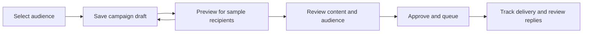

# Mailqivo product design

Mailqivo connects a Codex conversation to a mailing workspace on the user's machine. The Codex skills guide campaign preparation and reply triage. The web console exposes the settings and records used by those workflows.

## Campaign workflow

1. Add contacts in the console or import a spreadsheet. Select an audience from those records.
2. Save a subject, body, sender channel, and audience in a draft. Use placeholders such as `{{name}}` for recipient-specific text.
3. Preview selected contacts before approval. The rendering pipeline resolves placeholders and applies the campaign's content rules. When AI personalization is configured, the selected provider can receive the instructions and contact context needed for generation.
4. Approve the campaign to queue delivery. A worker sends queued mail through the selected channel and records send outcomes. Review results in the console.
5. When inbound polling is configured, Mailqivo associates incoming replies with campaign messages. Codex can summarize replies and suggest follow-up for the user to review.

## Components

| Component | Responsibility |
| --- | --- |
| Codex plugin | Registers Mailqivo skills and the connection to the local MCP server. |
| Web console | Manages contacts, campaigns, channels, reply records, and compliance settings. |
| API and MCP server | Authenticates requests, validates changes, renders previews, and exposes campaign and reply operations. |
| PostgreSQL | Stores contacts, draft content, settings, recipients, and delivery and reply records. |
| Workers | Run scheduled delivery and inbound polling when the server role enables them. |

## Data handling

Web access uses a signed session. MCP requests use a locally configured bearer token. Channel secrets are encrypted before storage using the application's encryption key. Keep the environment file and database directory private.

The sending provider receives messages and recipient addresses when delivery runs. Configured inbound and AI providers handle the requests needed for their respective features. Tracking and unsubscribe features require reachable public endpoints when recipients need to use those links outside the local machine. The hosted WentongCloud unsubscribe service serves WentongCloud campaigns. Other installations can [deploy the built-in unsubscribe endpoint](unsubscribe.md).

Campaign drafts and previews can be reviewed before delivery. The sample workspace uses synthetic data, a local mock for AI, and an API-only server without delivery workers.
